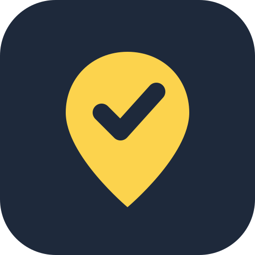
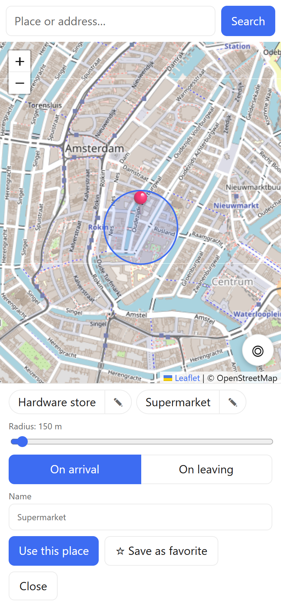
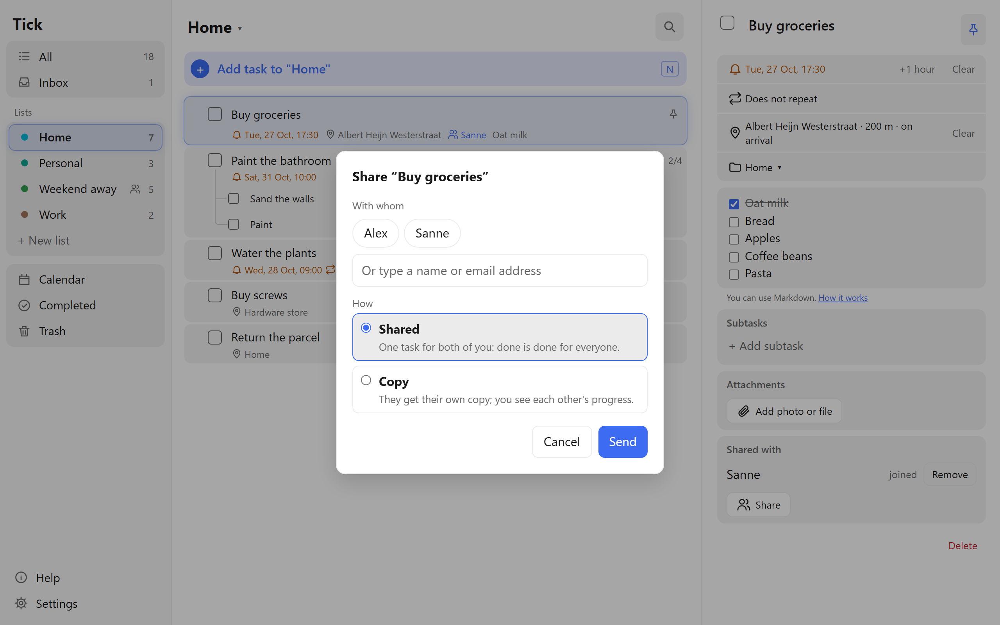
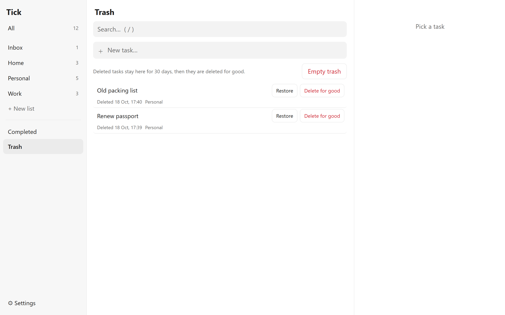

  

<h1 align="center">Tick</h1>

A to-do app you host yourself on Cloudflare: tasks, lists, reminders with push notifications, and it works offline. Its standout feature is **location reminders**: tie a task to a place and your phone reminds you when you arrive there or leave, so the shopping list pops up as you walk into the supermarket. Built for one person or a few: the administrator invites others with a link, and every account has its own tasks and settings. Free to run on Cloudflare's free plan.

**Set it up:** [SETUP.md](SETUP.md), or open this folder in [Claude Code](https://claude.com/claude-code) and say *"set up Tick"*.
**How it works:** [ARCHITECTURE.md](ARCHITECTURE.md).

## Screenshots

**On the desktop** you get three columns: your lists on the left, the tasks in the middle and the open task on the right. A task can have a reminder (🔔), a repeat rule (🔁), a list and subtasks. The notes are markdown, so a checklist in a note can be ticked off right there. Click a task and you can edit its title right in the list. Tick something off and a little burst of confetti comes out of the checkbox.

**📍 Location reminders** are the feature that sets Tick apart. Search for a place or address on the map, set the radius, choose *on arrival* or *on leaving*, and save places you use often as favorites. The Android app then notifies you at the right spot: the groceries at the supermarket, the screws at the hardware store, the parcel as you leave the house. A task can have a time reminder and a place reminder at the same time. (This screenshot also shows light mode: Tick follows your device, or you pick light or dark in the settings.)

  

**The location picker** on a phone: your favorite places sit right under the map, so a supermarket task gets its reminder in one tap.

**Sharing** works between the accounts on your Tick. Pick someone from the list (or type a name or email address) and choose *Shared*, one task for both of you, where done is done for everyone, or *Copy*, which gives them their own copy. They get an invitation at the top of their list to accept or decline. The task shows who it is shared with, and a reminder on a shared task reaches everyone on it. The owner can remove people; the others can stop sharing whenever they like. With a copy you see how far the others are, and you get a notification when one of them is done.

**The trash** keeps deleted tasks for 30 days. Restore one, delete it for good, or empty the trash in one go.

  
  

**On your phone** Tick is an installable web app that also works offline. The list fills the screen; tap a task to open it full screen, and drag the handle (⋮⋮) to sort. Changes you make offline sync once you are back online.

**📱 The Android widget** puts your open tasks on your home screen. Tick one off right in the widget (you get 3 seconds to undo), tap a task to open it in the app, or tap ➕ for quick add with an optional reminder. The widget refreshes in the background (or tap ↻), shows when it last synced, and you can resize it and set its text size and line spacing (long-press it, then *Widget settings*). Sharing text from another app to Tick turns it into a task.

**More in the app:** a 📅 calendar with a month grid and an agenda of every task with a date (repeating tasks show their coming dates too), 📌 pinning to keep a task at the top of its list, repeats that run until an end date, a daily notification for overdue tasks with *Done* and *Tomorrow* buttons, colour themes (such as *Retro 70s*) and your own background photo.

**Settings** live in the app itself: theme, text size and spacing (with a live preview), language and time zone, notifications, your password, keys for your phone and automations, and backup, restore and TickTick import.

*The screenshots use made-up demo tasks.*

## Features
- **Location reminders**: get a notification when you arrive at or leave a place, set on a map (with the Android app).
- Tasks with lists, one level of subtasks, drag to sort, search, and pinning to keep a task at the top of its list.
- Several accounts on one Tick; share a task with someone as one shared task (done is done for everyone) or as a separate copy. They accept or decline the invitation, and reminders on a shared task go to everyone on it. Copies stay linked: you see how far the others are and get a notification when one of them is done.
- A trash: deleted tasks stay there for 30 days; restore them, delete them for good, or empty the trash.
- Reminders with web push; a reminder can repeat (daily, weekly, monthly, yearly, with custom rules), forever or until an end date. A new reminder starts at the next whole hour.
- A daily notification for overdue tasks (09:00 by default, or switch it off), with *Done* and *Tomorrow* buttons.
- A calendar: month grid and agenda of your tasks with a date, including the coming dates of repeating tasks.
- Notes in markdown, with clickable checklists.
- Optional attachments: photos and files on a task, stored in Cloudflare R2. Photos are scaled down and lose their EXIF data (such as the location) before upload.
- Works offline as an installable web app (PWA); changes sync when you are back online.
- Desktop layout with a sidebar and detail panel, where you edit a task's title right in the list; a full-screen task view on mobile.
- Confetti when you tick off a task (not when your device asks for reduced motion).
- Colour themes (default or *Retro 70s*, each in light and dark) and an optional background photo of your own.
- Optional Android app: location reminders, a home-screen widget and quick add. Notifications show up as Tick instead of Chrome, and you link the app with one tap on *Link* in the web app.
- **Home-screen widget** (Android): your open tasks on the home screen, tick off with 3 seconds to undo, tap to open a task in the app, quick add with a reminder, resizable, with its own text size and line spacing.
- **Claude (MCP):** an MCP server at `/mcp`, so Claude Code or Claude Desktop can list, add, change, check off, snooze and delete your tasks with a key of its own (see step 12 of [SETUP.md](SETUP.md)).
- An inbox API for automations (`POST /api/inbox` with its own token).
- A settings page in the app: display (theme, text size, spacing), language per device, time zone, password, keys for your phone and automations, a view of your devices, and backup, restore and TickTick import. After the install you rarely need the config again.
- English and Dutch; your own time zone.

## Requirements
1. [Claude Code](https://claude.com/claude-code) (or do it by hand with [SETUP.md](SETUP.md)).
2. A free [Cloudflare](https://dash.cloudflare.com/sign-up) account. No credit card needed: only the optional attachments ask for a payment method on file (Cloudflare R2, see step 11 of [SETUP.md](SETUP.md)).
3. [Node.js](https://nodejs.org) 22 or newer and [git](https://git-scm.com). Claude Code checks this and tells you if something is missing.

## How to install (short version)
1. Make a free Cloudflare account and open **Workers & Pages** once in the dashboard, so your account gets its `workers.dev` address.
2. Open Claude Code in an empty folder that is **not** inside Google Drive, OneDrive or Dropbox (npm does not work well there).
3. Paste this:
   > Clone https://github.com/DioVayne/tick into this folder and set up Tick for me.
4. Answer Claude's questions: language, time zone, contact email, and whether you want the Android app and attachments.
5. When Claude asks, log in to Cloudflare in the browser window that opens, and type your own password in the terminal (`npx wrangler secret put LOGIN_PASSWORD`). Claude never sees it.
6. Open the URL Claude gives you, log in with an empty email address and that password, and turn on notifications under **⚙ Settings**.

Updating later: open the folder in Claude Code and say *"update Tick"*.

## Built with
A Cloudflare Worker ([Hono](https://hono.dev)) with D1, static assets and a cron trigger. The web app is vanilla JavaScript without a build step. Push through [@pushforge/builder](https://www.npmjs.com/package/@pushforge/builder), maps through [Leaflet](https://leafletjs.com) and OpenStreetMap.

## Commands
| | |
|---|---|
| `npm run dev` | Run locally on `http://127.0.0.1:8787` (copy `.dev.vars.example` to `.dev.vars`; `DEV_AUTH_BYPASS=1` skips the login, but only on `localhost` and `127.0.0.1`) |
| `npm run db:migrate:local` | Apply migrations to the local D1 (do this before `npm run dev`) |
| `npm run db:migrate` | Apply migrations to your production D1 |
| `npm run typecheck` | Check TypeScript (`src` and `test`) |
| `npm test` | Tests in the Workers runtime with a local D1 |
| `npm run deploy` | Deploy (run `npm run db:migrate` first) |
| `npm run vendor` | Copy `sortable.min.js`, `leaflet.js` and `leaflet.css` from `node_modules` to `public/` |
| `node scripts/gen-vapid.mjs` | New key pair for web push |
| `node scripts/import-ticktick.mjs <csv>` | Turn a TickTick backup into `import.sql` (the app can also import it: Settings → Data) |

## Tests
- Vitest stays on 4.1: with Vitest 5, `@cloudflare/vitest-plugin` 1.4 crashes on Windows ("File path must be a file: URL").
- The tests use your `wrangler.jsonc` when it exists and `wrangler.example.jsonc` otherwise (as in CI).

## Database and migrations
The schema lives in `migrations/` and is applied with `wrangler d1 migrations apply` (`npm run db:migrate`). A schema change is always a new file (`0006_….sql`); existing migrations are never edited.

## Security
- Your own login, no Cloudflare Access: email address and password on `/login`, then an HttpOnly cookie for 30 days, renewed automatically when you use Tick in the second half of that period.
- At most 5 login attempts per minute per IP (Workers Rate Limiting), then a 429.
- Android: `Authorization: Bearer <key>` with a key you make in the app (or the old `API_TOKEN`): full access to the tasks, but not to settings, keys or your password.
- Automations: an inbox key (or the old `INBOX_TOKEN`), only `POST /api/inbox`; everything else gives a 403.
- Keys are stored as a SHA-256 hash only and shown once; you can revoke them in the app. The password you set in the app is stored as a PBKDF2 hash.
- A strict Content-Security-Policy (no inline code), plus `X-Content-Type-Options`, `Referrer-Policy` and `Permissions-Policy` on every response.
- Without `SESSION_SECRET`, or without any password (none set in the app and no `LOGIN_PASSWORD`), nobody can log in (fail closed).
- **Log out on other devices:** Settings → Account. **Forgot your password:** see "Good to know" in [SETUP.md](SETUP.md).

## Contributing
Issues and pull requests are welcome. Every visible text goes into `public/i18n.js` in both `en` and `nl`; run `npm run typecheck` and `npm test` before you open a pull request.

## License
[MIT](LICENSE)
