

  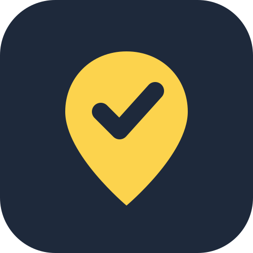

<h1 align="center">Tick</h1>

  <b>Your own free to-do app, for the web and Android.</b> 
  With reminders that know where you are.

> [!NOTE]
> **What you're getting**
> - ☁️ Tick runs on **your own free Cloudflare account**. Setting it up takes **about 15 minutes** with [Claude Code](#get-your-own-in-about-15-minutes): no server, no subscription, no ads.
> - 🤖 **Android:** an [app](https://github.com/DioVayne/tick/releases/latest/download/Tick.apk) with a home-screen widget and reminders by place. 🌐 **Web:** any browser, installable, works offline.
> - 🍎 **iPhone and iPad:** the [web app](docs/iphone.md) only for now, so reminders by time but **no reminders by place**.

  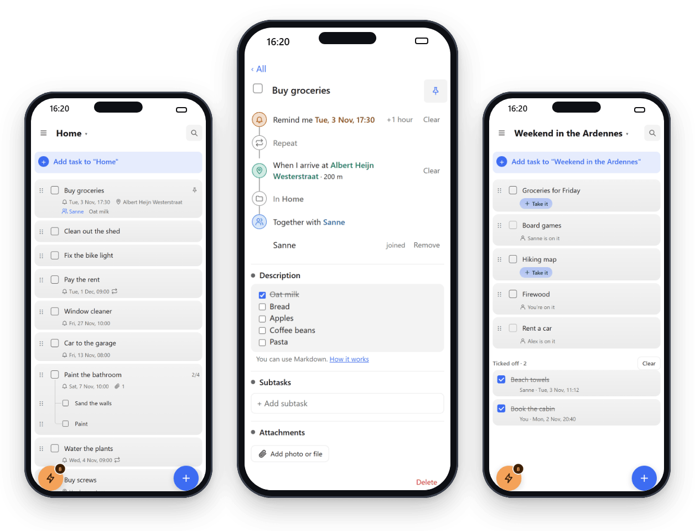

## 📍 Reminders by place

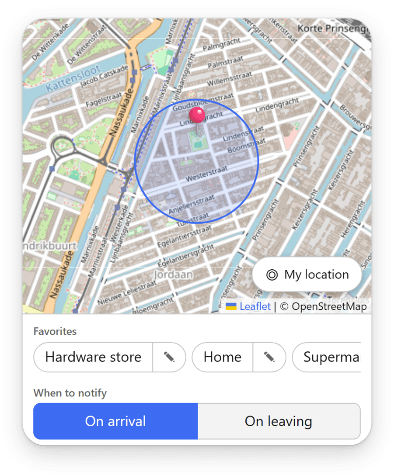

Your shopping list pops up as you walk into the supermarket. The screws, the moment you park at the hardware store. The parcel, as you step out the door.

Pin a place on the map, set the radius and choose **on arrival** or **on leaving**. Favorite places are one tap away, and a task can have a time *and* a place. Driving or cycling? Tick makes the circle bigger so the reminder is not late.

Your phone watches the places itself and only tells Tick that a reminder went off: there is no log of where you have been.

Remember <a href="https://www.howtogeek.com/google-killed-an-essential-keep-notes-feature-but-its-part-of-a-bigger-problem/">Google Keep</a> had this, until they took it away? Reminders by place need the Android app. More in [Places](docs/places.md).

 

## 👥 Share with the people you live with

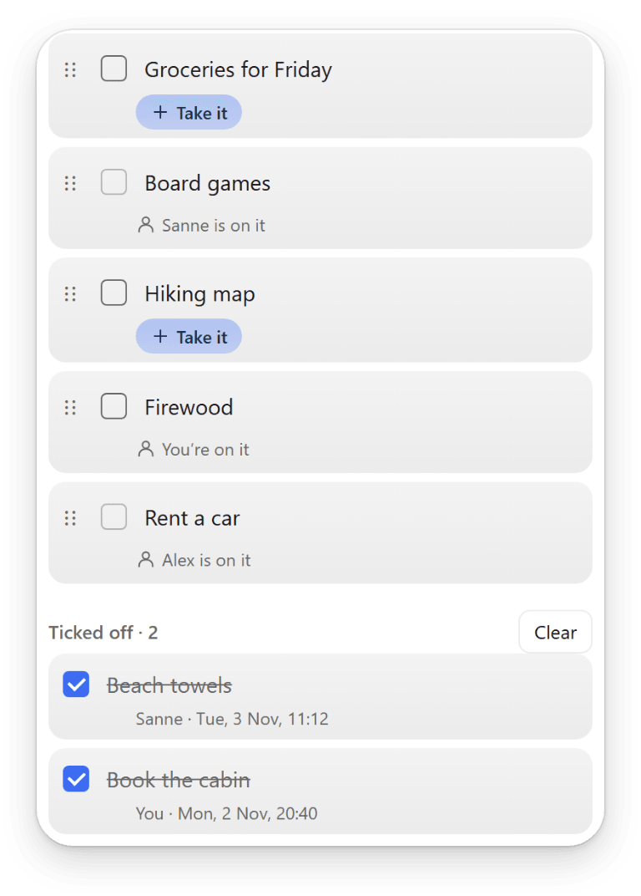

Your partner, friends or family each get their own account on your Tick.

**Share a whole list**, like the groceries for the house or the packing list for a weekend away. Everyone adds and ticks off. Tap **Take it** and the others see *Sanne is on it*, so nobody buys the board games twice. Ticked-off tasks show who did it and when.

**Or share one task**: as one task (done is done for everyone), or as a copy for each person so you see how far the others are. A reminder on a shared task reaches everyone on it.

More in [Sharing](docs/sharing.md).

 

## ⚡ Old tasks get a second chance

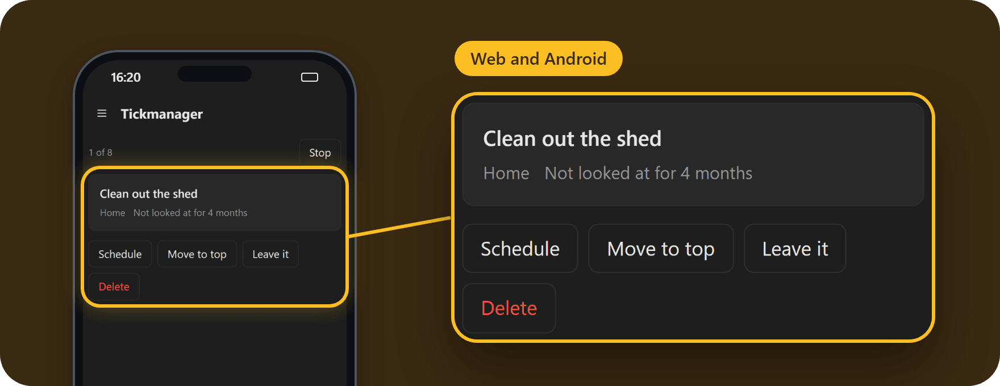

Every list has them: tasks that sank to the bottom months ago. The **Tickmanager** brings them back one at a time, oldest first, and you decide in one tap: **schedule** it, **move it to the top**, **leave it** or **delete** it.

An orange button shows how many are waiting. Pinned, repeating and planned tasks stay out of it, and you choose which lists take part. More in [Tickmanager](docs/tickmanager.md).

 

## Also in the box

<table>
  <tr>
    <td width="33%" valign="top">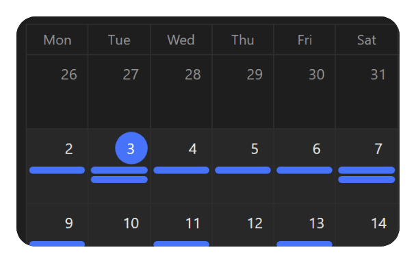 <b>📅 <a href="docs/reminders.md">Calendar</a></b> A month grid with your reminders.</td>
    <td width="33%" valign="top">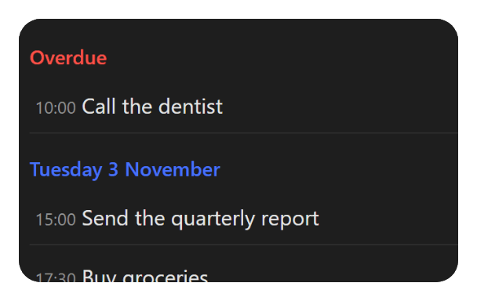 <b>🗓️ <a href="docs/reminders.md">Agenda</a></b> Everything ahead, day by day.</td>
    <td width="33%" valign="top">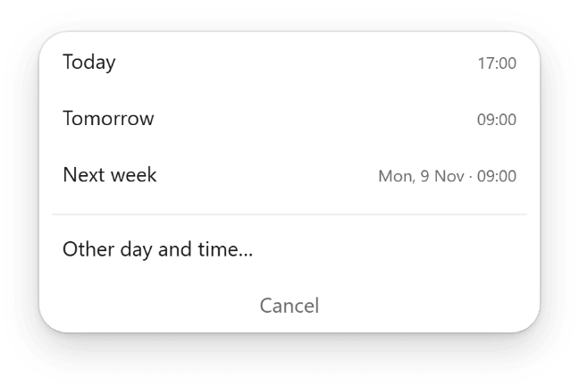 <b>🔔 <a href="docs/reminders.md">Reminders</a></b> Today, tomorrow or next week in one tap.</td>
  </tr>
  <tr>
    <td valign="top">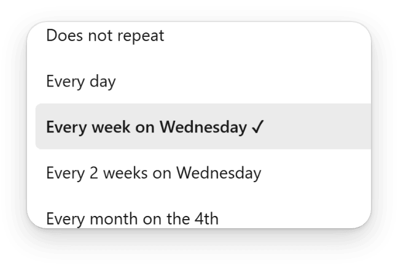 <b>🔁 <a href="docs/reminders.md">Repeating</a></b> Every week on Wednesday, until a date if you like.</td>
    <td valign="top">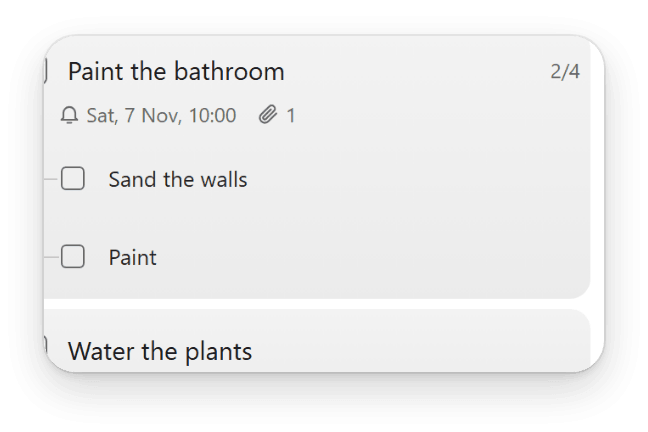 <b>☑️ <a href="docs/tasks-and-lists.md">Subtasks</a></b> 2/4 done, right in the list.</td>
    <td valign="top">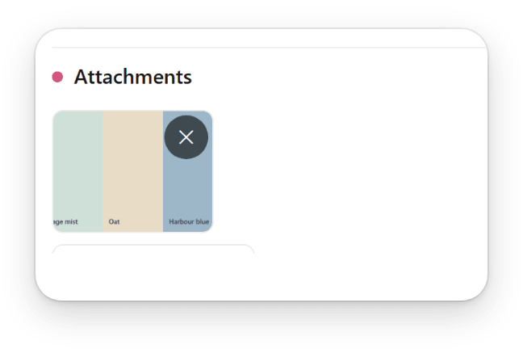 <b>📎 <a href="docs/tasks-and-lists.md">Photos and files</a></b> Add them to any task.</td>
  </tr>
  <tr>
    <td valign="top">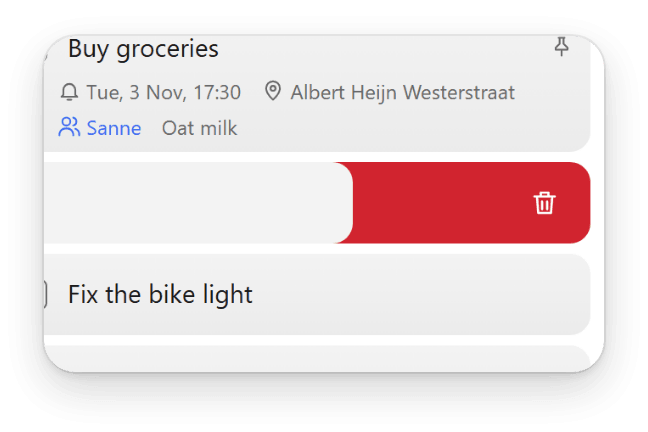 <b>👆 <a href="docs/tasks-and-lists.md">Swipe</a></b> Left to delete, right to move it to another list.</td>
    <td valign="top">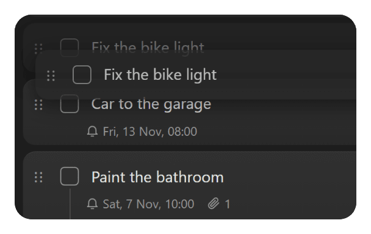 <b>↕️ <a href="docs/tasks-and-lists.md">Drag and drop</a></b> Put your tasks in the order you want.</td>
    <td valign="top">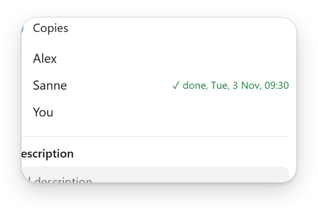 <b>👪 <a href="docs/sharing.md">Group tasks</a></b> Everyone their own copy; see who is done.</td>
  </tr>
  <tr>
    <td valign="top">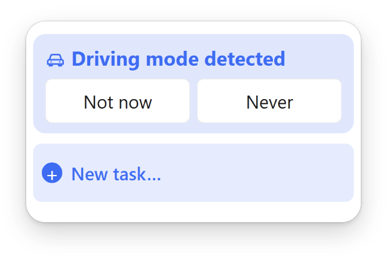 <b>🚗 <a href="docs/driving-mode.md">Driving mode</a></b> Big and simple while you drive, nearby tasks first.</td>
    <td valign="top">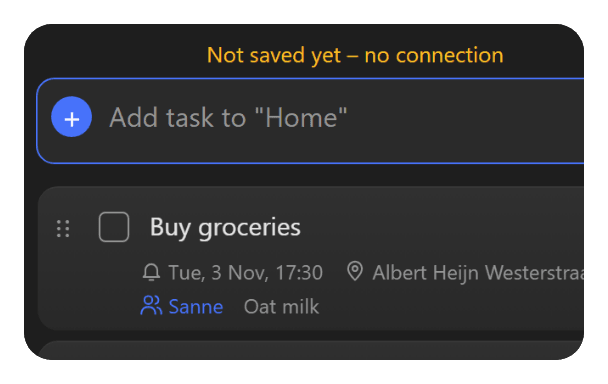 <b>✈️ <a href="docs/tasks-and-lists.md">Works offline</a></b> Changes are sent when you are back online.</td>
    <td valign="top">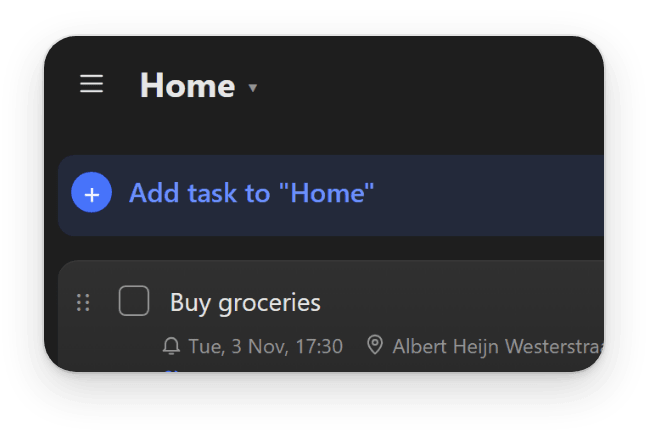 <b>🌙 <a href="docs/settings.md">Dark mode</a></b> And colour themes with your own background photo.</td>
  </tr>
</table>

And: a [home-screen widget](docs/android.md) on Android, pinning, search, notes in markdown with checklists, a trash that keeps tasks for 30 days, a daily nudge for overdue tasks, [TickTick import](docs/settings.md), English and Dutch, and an [MCP server](docs/integrations.md) so Claude can manage your tasks.

The screenshots use made-up demo tasks. How they are made: [docs/screenshots/src](docs/screenshots/src/README.md).

## Get your own in about 15 minutes

You don't need to be a developer. Open [Claude Code](https://claude.com/claude-code) in an empty folder and paste:

> Clone https://github.com/DioVayne/tick into this folder and set up Tick for me.

Claude asks a few questions (language, time zone, Android app or not), sets everything up on your free Cloudflare account and gives you your own link. Prefer doing it by hand? Follow [SETUP.md](SETUP.md). The details are under [How to install](#how-to-install-short-version) below.

> [!TIP]
> On Android, [download the app](https://github.com/DioVayne/tick/releases/latest/download/Tick.apk), open it and type the address of your Tick. The app tells you when there is an update. On an iPhone, put Tick on your home screen from Safari: see [iPhone and iPad](docs/iphone.md).

<b>All features</b>, with a page in the <a href="docs/README.md">user guide</a> for each topic

- **[Places](docs/places.md):** a notification when you arrive at or leave a place, set on a map, with favorite places; *Notify again* when you want it once more, and *On time on the road*, which makes circles bigger while you drive or cycle so the notification is not late (with the Android app).
- **[Tasks and lists](docs/tasks-and-lists.md):** lists, one level of subtasks with a counter (2/4), drag to sort (on a phone: hold and drag), swipe on a phone, search, pinning, notes in markdown with clickable checklists, optional photos and files (stored in Cloudflare R2, photos lose their EXIF data), and a trash that keeps deleted tasks for 30 days. Works offline as an installable web app; changes sync when you are back online.
- **[Reminders](docs/reminders.md):** web push at a time, repeating (daily, weekly, monthly, yearly, custom rules, until an end date if you like), a daily notification for overdue tasks with *Done* and *Tomorrow*, a calendar with a month grid and agenda, and a counter on the app icon.
- **[Sharing](docs/sharing.md):** several accounts on one Tick; share a whole list (everyone adds and ticks off, *Take it* puts a task on your name, ticked-off tasks show who did it), or share one task as a shared task (done is done for everyone) or as linked copies where you see how far the others are.
- **[Tickmanager](docs/tickmanager.md):** tasks you have not looked at in a while come back one by one (after 14 days, or 30 after a tidy-up), oldest first; schedule, move to the top, leave or delete; skip lists you do not want in it.
- **[Driving mode](docs/driving-mode.md):** when Tick notices you are driving, a bigger, simpler view with nearby tasks first; *Not now* or *Never*.
- **[Android app](docs/android.md):** place reminders (on time on the road too), a resizable home-screen widget (tick off with 3 seconds to undo, quick add, a list or *Today* per widget), notifications as Tick instead of Chrome, and an update check. [Download it](https://github.com/DioVayne/tick/releases/latest/download/Tick.apk).
- **[iPhone and iPad](docs/iphone.md):** Tick on your home screen from Safari, with notifications (iOS 16.4 or newer); no reminders by place.
- **[Settings](docs/settings.md):** theme, colour theme (such as *Retro 70s*) and your own background photo, text size, language per device, time zone, password, keys, your devices, backup and restore, and TickTick import. After the install you rarely need the config again.
- **[Integrations](docs/integrations.md):** an MCP server so Claude can manage your tasks, an inbox API for automations, a Home Assistant package, and a fallback webhook.
- Desktop layout with a sidebar and a detail panel; a full-screen task view on mobile. Confetti when you tick off a task (not when your device asks for reduced motion).
- English and Dutch; your own time zone.

## Requirements
1. [Claude Code](https://claude.com/claude-code) (or do it by hand with [SETUP.md](SETUP.md)).
2. A free [Cloudflare](https://dash.cloudflare.com/sign-up) account. No credit card needed: only the optional attachments ask for a payment method on file (Cloudflare R2, see step 11 of [SETUP.md](SETUP.md)).
3. [Node.js](https://nodejs.org) 22 or newer and [git](https://git-scm.com). Claude Code checks this and tells you if something is missing.

## How to install (short version)
1. Make a free Cloudflare account and open **Workers & Pages** once in the dashboard, so your account gets its `workers.dev` address.
2. Open Claude Code in an empty folder that is **not** inside Google Drive, OneDrive or Dropbox (npm does not work well there).
3. Paste this:
   > Clone https://github.com/DioVayne/tick into this folder and set up Tick for me.
4. Answer Claude's questions: language, time zone, contact email, and whether you want the Android app and attachments.
5. When Claude asks, log in to Cloudflare in the browser window that opens, and type your own password in the terminal (`npx wrangler secret put LOGIN_PASSWORD`). Claude never sees it.
6. Open the URL Claude gives you, log in with an empty email address and that password, and turn on notifications under **⚙ Settings**.

Updating later: open the folder in Claude Code and say *"update Tick"*.

## Built with
A Cloudflare Worker ([Hono](https://hono.dev)) with D1, static assets and a cron trigger. The web app is vanilla JavaScript without a build step. Push through [@pushforge/builder](https://www.npmjs.com/package/@pushforge/builder), maps through [Leaflet](https://leafletjs.com) and OpenStreetMap.

## Commands
| | |
|---|---|
| `npm run dev` | Run locally on `http://127.0.0.1:8787` (copy `.dev.vars.example` to `.dev.vars`; `DEV_AUTH_BYPASS=1` skips the login, but only on `localhost` and `127.0.0.1`) |
| `npm run db:migrate:local` | Apply migrations to the local D1 (do this before `npm run dev`) |
| `npm run db:migrate` | Apply migrations to your production D1 |
| `npm run typecheck` | Check TypeScript (`src` and `test`) |
| `npm test` | Tests in the Workers runtime with a local D1 |
| `npm run deploy` | Deploy (run `npm run db:migrate` first) |
| `npm run vendor` | Copy `sortable.min.js`, `leaflet.js` and `leaflet.css` from `node_modules` to `public/` |
| `node scripts/gen-vapid.mjs` | New key pair for web push |
| `node scripts/import-ticktick.mjs <csv>` | Turn a TickTick backup into `import.sql` (the app can also import it: Settings → Data) |

## Tests
- Vitest stays on 4.1: with Vitest 5, `@cloudflare/vitest-plugin` 1.4 crashes on Windows ("File path must be a file: URL").
- The tests use your `wrangler.jsonc` when it exists and `wrangler.example.jsonc` otherwise (as in CI).

## Database and migrations
The schema lives in `migrations/` and is applied with `wrangler d1 migrations apply` (`npm run db:migrate`). A schema change is always a new file (`0006_….sql`); existing migrations are never edited.

## Security
- Your own login, no Cloudflare Access: email address and password on `/login`, then an HttpOnly cookie for 30 days, renewed automatically when you use Tick in the second half of that period.
- At most 5 login attempts per minute per IP (Workers Rate Limiting), then a 429.
- Android: `Authorization: Bearer <key>` with a key you make in the app (or the old `API_TOKEN`): full access to the tasks, but not to settings, keys or your password.
- Automations: an inbox key (or the old `INBOX_TOKEN`), only `POST /api/inbox`; everything else gives a 403.
- Keys are stored as a SHA-256 hash only and shown once; you can revoke them in the app. The password you set in the app is stored as a PBKDF2 hash.
- A strict Content-Security-Policy (no inline code), plus `X-Content-Type-Options`, `Referrer-Policy` and `Permissions-Policy` on every response.
- Without `SESSION_SECRET`, or without any password (none set in the app and no `LOGIN_PASSWORD`), nobody can log in (fail closed).
- **Log out on other devices:** Settings → Account. **Forgot your password:** see "Good to know" in [SETUP.md](SETUP.md).

## Contributing
Issues and pull requests are welcome. Every visible text goes into `public/i18n.js` in both `en` and `nl`; run `npm run typecheck` and `npm test` before you open a pull request.

## License
[MIT](LICENSE)
