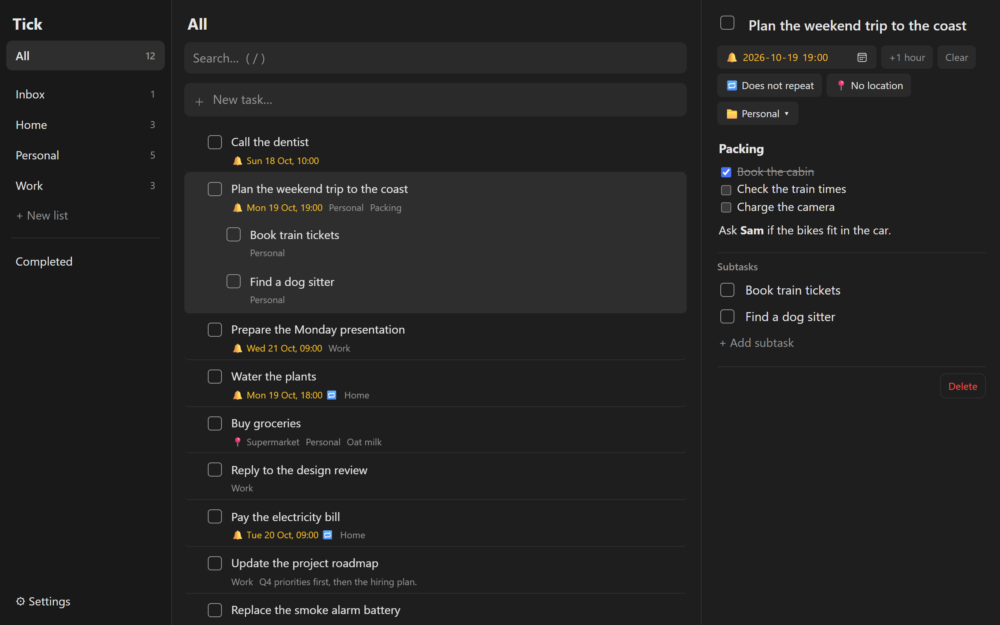
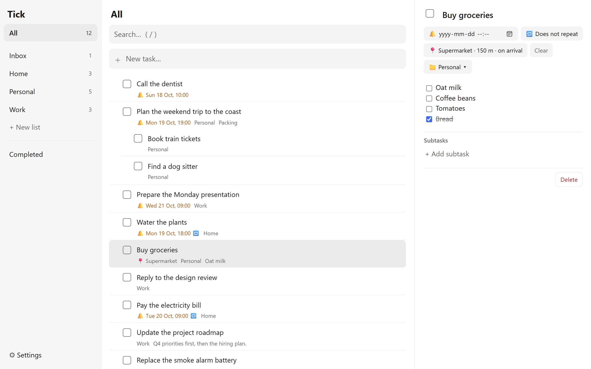
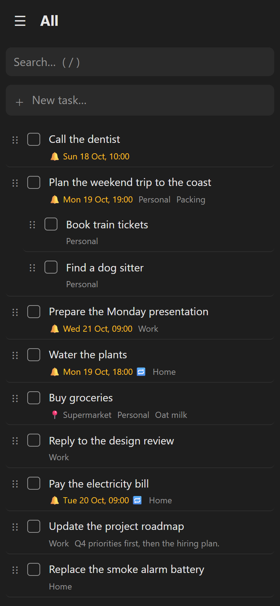
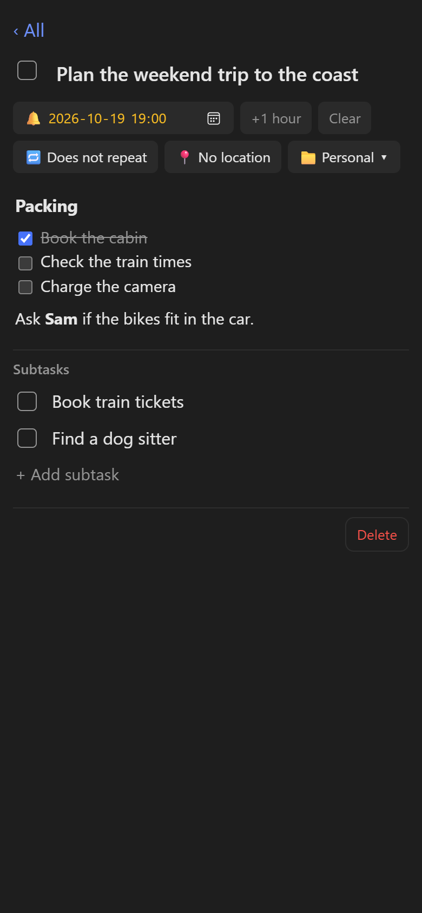
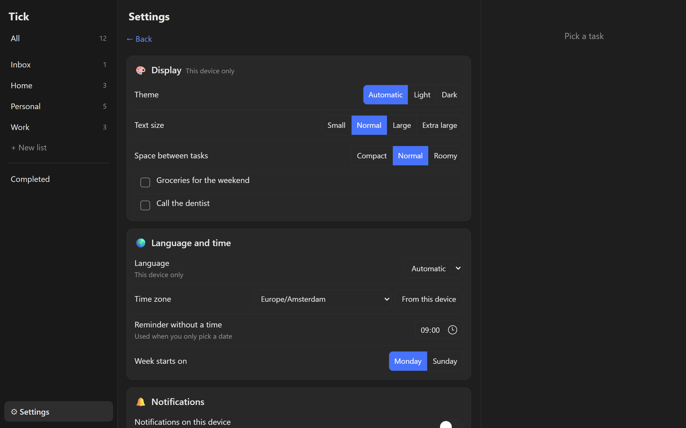

# Tick

A to-do app you host yourself on Cloudflare: tasks, lists, reminders with push notifications, and it works offline. Built for one person or a few: the administrator invites others with a link, and every account has its own tasks and settings. Free to run on Cloudflare's free plan.

**Set it up:** [SETUP.md](SETUP.md), or open this folder in [Claude Code](https://claude.com/claude-code) and say *"set up Tick"*.
**How it works:** [ARCHITECTURE.md](ARCHITECTURE.md).

## Screenshots

**On the desktop** you get three columns: your lists on the left, the tasks in the middle and the open task on the right. A task can have a reminder (🔔), a repeat rule (🔁), a list and subtasks. The notes are markdown, so a checklist in a note can be ticked off right there.

**Light or dark** follows your device, or you pick one in the settings. Here a shopping task has a location reminder: with the Android app you get a notification when you arrive at the supermarket.

  
  

**On your phone** Tick is an installable web app that also works offline. The list fills the screen; tap a task to open it full screen, and drag the handle (⋮⋮) to sort. Changes you make offline sync once you are back online.

**Settings** live in the app itself: theme, text size and spacing (with a live preview), language and time zone, notifications, your password, keys for your phone and automations, and backup, restore and TickTick import.

*The screenshots use made-up demo tasks.*

## Features
- Tasks with lists, one level of subtasks, drag to sort, and search.
- Reminders with web push; a reminder can repeat (daily, weekly, monthly, yearly, with custom rules).
- Notes in markdown, with clickable checklists.
- Works offline as an installable web app (PWA); changes sync when you are back online.
- Desktop layout with a sidebar and detail panel; a full-screen task view on mobile.
- Optional Android app: a home-screen widget, quick add, and location reminders (notify me when I arrive at or leave a place).
- An inbox API for automations (`POST /api/inbox` with its own token).
- A settings page in the app: display (theme, text size, spacing), language per device, time zone, password, keys for your phone and automations, a view of your devices, and backup, restore and TickTick import. After the install you rarely need the config again.
- English and Dutch; your own time zone.

## Built with
A Cloudflare Worker ([Hono](https://hono.dev)) with D1, static assets and a cron trigger. The web app is vanilla JavaScript without a build step. Push through [@pushforge/builder](https://www.npmjs.com/package/@pushforge/builder), maps through [Leaflet](https://leafletjs.com) and OpenStreetMap.

## Commands
| | |
|---|---|
| `npm run dev` | Run locally on `http://127.0.0.1:8787` (copy `.dev.vars.example` to `.dev.vars`; `DEV_AUTH_BYPASS=1` skips the login, but only on `localhost` and `127.0.0.1`) |
| `npm run db:migrate:local` | Apply migrations to the local D1 (do this before `npm run dev`) |
| `npm run db:migrate` | Apply migrations to your production D1 |
| `npm run typecheck` | Check TypeScript (`src` and `test`) |
| `npm test` | Tests in the Workers runtime with a local D1 |
| `npm run deploy` | Deploy (run `npm run db:migrate` first) |
| `npm run vendor` | Copy `sortable.min.js`, `leaflet.js` and `leaflet.css` from `node_modules` to `public/` |
| `node scripts/gen-vapid.mjs` | New key pair for web push |
| `node scripts/import-ticktick.mjs <csv>` | Turn a TickTick backup into `import.sql` (the app can also import it: Settings → Data) |

## Tests
- Vitest stays on 4.1: with Vitest 5, `@cloudflare/vitest-plugin` 1.4 crashes on Windows ("File path must be a file: URL").
- The tests use your `wrangler.jsonc` when it exists and `wrangler.example.jsonc` otherwise (as in CI).

## Database and migrations
The schema lives in `migrations/` and is applied with `wrangler d1 migrations apply` (`npm run db:migrate`). A schema change is always a new file (`0006_….sql`); existing migrations are never edited.

## Security
- Your own login, no Cloudflare Access: email address and password on `/login`, then an HttpOnly cookie for 30 days, renewed automatically when you use Tick in the second half of that period.
- At most 5 login attempts per minute per IP (Workers Rate Limiting), then a 429.
- Android: `Authorization: Bearer <key>` with a key you make in the app (or the old `API_TOKEN`): full access to the tasks, but not to settings, keys or your password.
- Automations: an inbox key (or the old `INBOX_TOKEN`), only `POST /api/inbox`; everything else gives a 403.
- Keys are stored as a SHA-256 hash only and shown once; you can revoke them in the app. The password you set in the app is stored as a PBKDF2 hash.
- A strict Content-Security-Policy (no inline code), plus `X-Content-Type-Options`, `Referrer-Policy` and `Permissions-Policy` on every response.
- Without `SESSION_SECRET`, or without any password (none set in the app and no `LOGIN_PASSWORD`), nobody can log in (fail closed).
- **Log out on other devices:** Settings → Account. **Forgot your password:** see "Good to know" in [SETUP.md](SETUP.md).

## Contributing
Issues and pull requests are welcome. Every visible text goes into `public/i18n.js` in both `en` and `nl`; run `npm run typecheck` and `npm test` before you open a pull request.

## License
[MIT](LICENSE)
