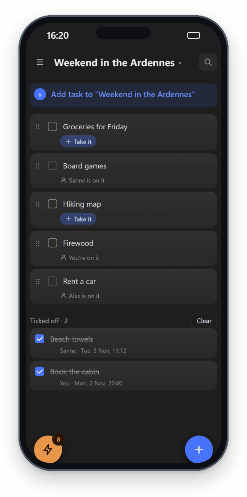
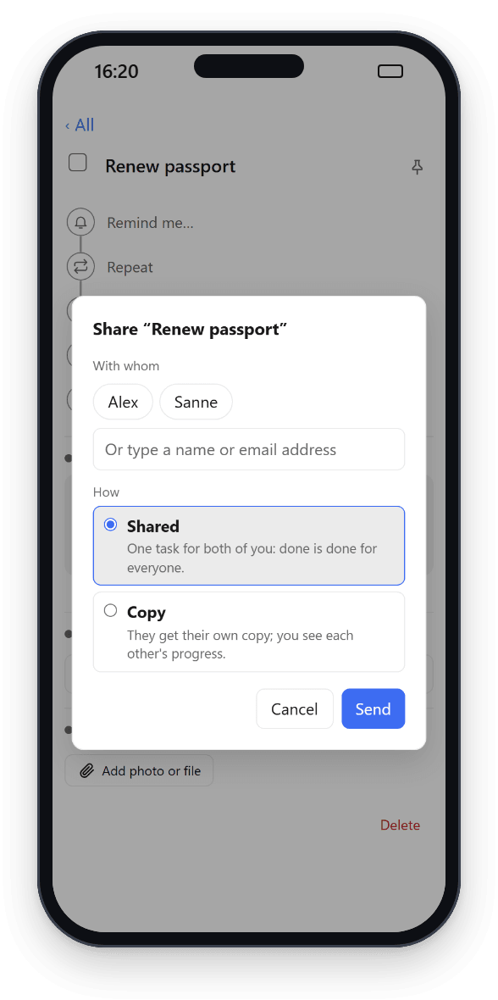

# Sharing

## Accounts
One Tick can have several accounts, for example everyone in your household. Each person has their own tasks, lists, places and settings.

The administrator (whoever installed Tick) invites people under **⚙ Settings → Accounts → + Invite someone**. That gives a one-time link, valid for 7 days, to send by any app you like. The other person opens it and picks a name, email address and password.

Forgot a password? If the administrator has set up email, tap **Forgot password?** on the login page and enter your email address: you get an email with a link (valid for 1 hour) to choose a new password. No email? Check your spam folder; you can ask for a new link after 5 minutes. Otherwise the administrator makes a **Reset link** (valid for 1 hour) at that account and sends it to you. Email links are only for members, not for the administrator. The administrator's own lost password is covered under "Good to know" in [SETUP.md](../SETUP.md#good-to-know).

## Sharing a list
Working on one list together, such as a packing list for a holiday or a weekend away with friends? Share the whole list, and every task in it is shared with everyone in the list. Nobody has to accept tasks one by one.

- **Share:** open the list menu (right-click, a long press, **⋯**, or the list name at the top) and choose **Share…**. Pick one or more people. The dialog shows who is in the list and who has not answered yet. A shared list has a small people icon next to its name in the sidebar.
- **Accept once:** the other person gets a notification with **Accept** and **Decline**, and a bar at the top of Tick. After accepting, the list is in their sidebar with all its tasks. If they already have a list with that name, the shared one gets the owner's name after it, such as "Holiday (Dio)"; each person can rename it for themselves.
- **Everyone can do everything:** anyone in the list can add, change, tick off and delete tasks. A new task is shared with everyone straight away. A deleted task goes to everyone's trash.
- **Take it:** tap the blue **Take it** button under an open task to put it on your name, for example "Find a car" or "Beach ball". It is the only coloured button on a task; the time and who is on it are in grey. The others then see "*Name* is on it", and only you can tick it off; their checkbox is greyed out. Tap your own **You're on it** to let go, so someone else can take it.
- **Ticked off stays:** a ticked-off task does not vanish. It moves to the **Ticked off** block at the bottom of the list, newest first, with who ticked it off and when ("Sanne · Sun 25 Oct, 17:10"). Tap its checkbox to reopen it. **Clear** moves all ticked-off tasks to the trash, for everyone. Ticked-off tasks do not count in the number in the sidebar.
- **Notifications:** by default you get no notification when someone else ticks off a task. Turn on **Notify when ticked off** in the list menu to hear about every task, or, while that is off, open a task and tap **Notify me when this is ticked off** for just that one. You never get a notification for your own tick.
- **Dragging a task out:** drag a task to one of your own lists and it is yours alone; it quietly disappears for the others. Drag a task of your own into a shared list and it is shared with everyone.
- **Leaving:** a member chooses **Leave…** in the list menu. The list and its tasks disappear for them; the tasks stay in the list for everyone else, including the ones they added. Whatever was on their name is free again.
- **Removing someone:** only the person who shared the list (the owner) can invite people and remove them, in the **Share…** dialog. It works the same as leaving, and the person gets a notification.
- **Deleting:** only the owner can delete a shared list (**Delete…**). The confirmation names the members, because the list and all its tasks disappear for them too. With **Move tasks to Inbox** only you keep the tasks, as your own; otherwise they go to everyone's trash, and only you can restore them.

Sharing, accepting, leaving, removing someone, notifications and **Clear** only work while online. Adding, ticking off and **Take it** also work offline and are sent once you are back online; if two people take the same task offline, whoever comes online first gets it.

Within a shared list, only the list's owner can send someone a **copy** of a task (see below); nobody can share a single task again.

A task that you had already shared on its own with someone outside the list, before you shared the list, stays shared with them as an ordinary shared task: they keep it in their own list, get the usual notifications, and cannot use **Take it**.

## Sharing a task
Open a top-level task and tap **Do it together with…**. Pick someone and choose how:

- **Shared:** one task for everyone. Done is done for everyone, and everyone can change it and add subtasks. Each person keeps it in their own list and order. A reminder (time or place) reaches everyone on it, so whoever passes the supermarket first does the shopping. When someone ticks it off or gives it a place, the others get a notification.
- **Copy:** the other person gets their own copy, with all subtasks open. You each tick off your own.

### Shared or copy: how to tell
- **Shared** has the people icon in blue, with the names: "Shared with Sanne", or "Waiting for Sanne" until she accepts. In the task, *Together with* says **Ticking it off counts for everyone.**
- **Copy** has a grey icon of two sheets, followed by a pill per person (see below), or "Copy, waiting for Sanne" until she accepts. In the task, the line says **Copy sent to Sanne** on yours and **Copy from Dio** on the one you received, with **Everyone ticks off their own copy.**
- The Android widget shows the same two icons: blue people for shared, grey sheets for a copy (from app version 1.12.3).

The other person gets a notification with **Accept** and **Decline**, and a bar in the app; an accepted task lands in their Inbox. If they have Tick open, the bar appears by itself: straight away with notifications on, otherwise when they click into Tick or within two minutes. Only the owner can invite others. Anyone on a shared task can leave it; the owner can remove people or withdraw an invitation. Who is on it is listed in the task under *Together with*. Deleting a shared task deletes it for everyone.

## On an open Tick
On a Tick where everyone makes their own account (such as the one behind the Android app in Google Play), sharing works the same, with three differences, so that nobody can find out who else uses it:

- **By email address:** there is no list of accounts to pick from. Type the full email address of the person you want to share with. People you already share an accepted task or list with appear as a button.
- **Confirm first:** you can share once your own email address is confirmed (see [Creating your own account](signup.md)).
- **An address without an account:** Tick emails that address an invitation with your name, the name of the task or list, and how to get Tick. The button in that email is a personal link: it opens the sign-up screen with their address filled in. Whoever signs up through that link gets the invitation, even with another email address; someone who already has an account can sign in through the link and gets it in that account. An invitation stays open for 30 days.

- **Free version: one person.** You can share with one other person: as many tasks and lists as you like, but all with that same person (the administrator can change the number). Tasks, lists and invitations by email all count; what others share with you does not, so you can always accept an invitation. Trying to share with a second person gives a message saying so.

Something shared with you that shouldn't be? You can report it and block the person: see [Reporting and blocking](reporting.md).

You always see the same thing, whether or not the address has an account: *Together with* or the list dialog shows the address with "waiting for an answer" until they accept, and then their name. You can withdraw an invitation there with **Remove**.

## Seeing how far the others are
Copies stay linked. On your copy you see the copy icon and a pill per person: their name with a small progress bar, or their name with ✓ when they are done. Progress counts their subtasks and the checklist lines in their notes. You never see their title, notes or subtasks.

When someone ticks off their copy, the others get a notification "*Name* is done ✓".

Each person can have only one copy of the same task.
